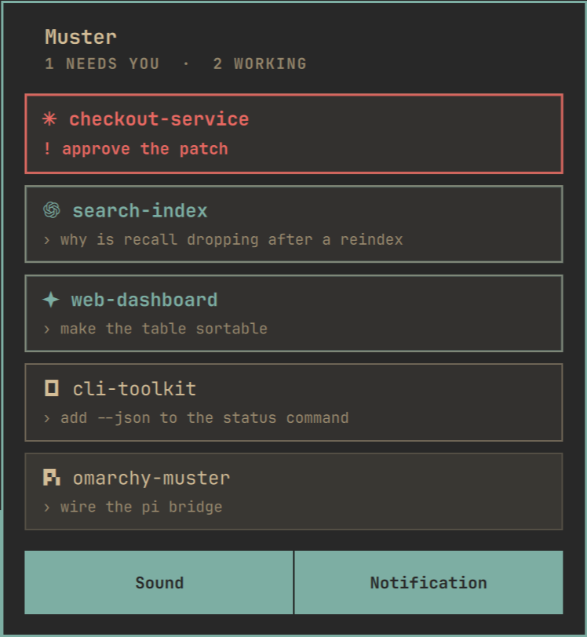
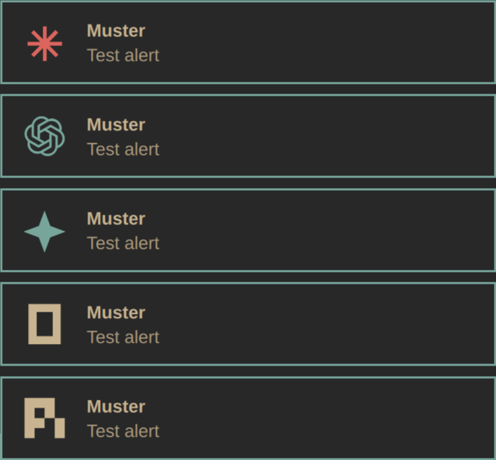

# Muster

[English](README.md) · **中文**

> [!WARNING]
> **纯协议实验 —— 还不能当日常插件用,未发布。**
> 这个分支只有一条通路:agent 自己会说[程序状态协议][osc7501](OSC 7501),
> 在 `bin/muster-tap` 下面跑,tap 把它的上报变成状态栏读的 JSON 记录。这里
> **没有写入脚本、没有 agent 桥接、没有 hook**:不会说这个协议的 agent 就不是
> 会话;卡片上**没有 prompt**;只有程序发 `title` 时才有会话名(pi 原生发的是 `msg`,所以经常没有)。record
> 契约、写入器、UI 都还在动,会有破坏性更改。请勿安装或依赖这个分支,完整
> 插件仍然是 `main`。协议细节见 [`docs/osc7501.md`](docs/osc7501.md),支持矩阵见
> [`docs/native-emitters.md`](docs/native-emitters.md)。

在 Omarchy 状态栏里看住你的 coding agent:谁在跑、谁在等你、谁刚干完活 ——
完成时还有提示音和系统弹窗;不要求任何终端复用器,而用了 tmux 或 herdr 时,
点一下也能直接跳到对应的 pane。

- **状态栏图标** —— 每个有会话的 agent 一个标记,按"谁更急"排序(先 blocked,
  再 working)。每个标记按**自己那个会话的状态**着色:blocked 用警示色、working 用
  主题强调色、idle 用状态栏文字色 —— 混在一起也能一眼分清,而不是整条图标全变成
  同一种颜色。标记用的是 **omarchy 自己的品牌字形**(`omarchy default agent`
  菜单里用的那一套),不是我自己凑的符号。窗口刻意做窄:超过 5 个标记就裁剪并
  滚动(和 omarchy 媒体插件跑长歌名的方式一样),再忙也不会把时钟挤走。它始终
  显示;没有会话时是一枚铃铛 —— 会消失的图标是点不开的图标。
- **面板**(点图标打开)—— 每个会话一张卡片:agent 的标记 + 它所在的项目文件夹,
  下面一行是状态要说的话(协议自己的 `msg`:阻塞时,或一次运行结束时)。卡片上不写
  agent 名字 —— 标记说明是谁,文件夹说明在哪 —— 也没有 prompt:协议不带 prompt。
  卡片内部永远是同一个灰色,状态体现在**边框和标题**上:working 是柔和的主题色
  呼吸边框,blocked 用警示色,idle 不变。没有计时器:面板只回答"有没有在跑、要不要我
  去看"。
- **提醒** —— 一次运行结束时响一声 + 发一条 Omarchy 通知;点通知会聚焦到那个终端,
  如果会话在 tmux 或 herdr 里,还会切到它所在的 pane。
  面板里**左键点卡片**同样聚焦到那个终端,**右键点卡片**则按需触发同样的提醒,
  通知标题会带上 `test`,不会和真实完成混淆。

## 截图






截图放在 [`assets/`](assets/README.md);市场列表卡片是仓库根目录下可选的一个
`preview.png`。

## 状态是怎么来的

**只认上报,从不猜。** Muster 说的是[程序状态协议][osc7501](OSC 7501)—— 程序向终端
汇报自己在干什么的终端原生方式:`idle`、`working`、`done`、`blocked`、`error`,
外加 `kind`、`progress` 和一行 `msg`。agent 自己把这个协议序列写给终端;
`bin/muster-tap` 站在 pty 路径上,回答探测查询,把每条上报变成一条小 JSON 记录,
插件监听这个目录。状态从不来自窗口标题或进程列表,也没有规则引擎 —— 没有任何会
猜错状态、或者悄悄失效的东西。(会话开始时会沿父进程链查一次窗口 id,但那只是
为了让点击能聚焦到正确的终端,从不参与判断状态。)

这个分支只有**一个写入者**:tap。它自己写记录,用的是 Python 标准库 —— 没有 shell
管道、没有 `jq`、没有锁文件、没有写入进程。记录先写暂存文件、落盘、再改名到位,
读取端永远看不到半条记录;会话目录只打开一次,每一次写入都走那个描述符。

已经会说这个协议的 agent(Claude Code 2.1.295+、pi 1.1.0+、Crush 0.98+、
omp 18.8.7+、Codex 0.163.0+ 等)根本不需要任何 per-agent 代码:用 `bin/muster-tap`
跑它们,上报就变成记录。矩阵(含上游证据)见
[`docs/native-emitters.md`](docs/native-emitters.md)。

[osc7501]: https://www.superlogical.com/rex/docs/build/program-status

## 安装

```bash
# 1. 安装 shell 插件
omarchy plugin add https://github.com/77-223255/omarchy-muster.git --enable
omarchy plugin enable shienze.muster left     # 如果上面没加 --enable,这里选位置

# 2. 体检:它依赖的每个外部命令都会检查一遍
~/.config/omarchy/plugins/shienze.muster/bin/muster-doctor
```

改 `.qml` 是热重载的,但 `Model.js` 是 QML 缓存的库,和 IPC 目标一样要
`omarchy restart shell` 才会更新。

### 从源码目录开发

`omarchy plugin add` 已经会在 `~/.config/omarchy/plugins/shienze.muster/` 留下一个
完整的 Git checkout(带 `origin` remote),直接在那里改就行:保存 `.qml` 就热重载,
也能像别的 clone 一样开分支、提交、推送。`omarchy plugin update shienze.muster`
会把上游的新提交拉进这个目录。

如果你想改自己另外放的 checkout,就用软链把插件路径指过去 —— shell 会跟随软链,
插件 id 仍然来自 `manifest.json`:

```bash
ln -sfn ~/Projects/omarchy-muster ~/.config/omarchy/plugins/shienze.muster
omarchy-shell shell rescanPlugins
omarchy plugin enable shienze.muster left
```

## 卸载

```bash
# 1. 移除 shell 插件(会删掉状态栏条目和插件目录)
omarchy plugin disable shienze.muster
omarchy plugin remove shienze.muster

# 2. 删掉它读的会话记录
rm -rf "${XDG_STATE_HOME:-$HOME/.local/state}/omarchy/muster"
```

`omarchy plugin remove` 只做两件事:删插件目录、删 `~/.config/omarchy/shell.json`
里的那条条目。如果你是上面那种"软链 checkout"的装法,改成删软链和你的 clone:

```bash
rm -f ~/.config/omarchy/plugins/shienze.muster
rm -rf ~/Projects/omarchy-muster
```

除了 `~/.config/omarchy/` 和 state home,它不写任何文件;也不会在你不知情的情况下
覆盖用户配置(改设置只有你在面板里点)。state home 是 `$XDG_STATE_HOME`(默认
`~/.local/state`),插件在其中创建 `omarchy/muster/sessions` 与 `omarchy/muster/marks`
——如果 `omarchy` 或 `~/.local/state` 还不存在也会一并创建。卸载插件不会删除这些状态,
上面的卸载步骤会。(完成提醒还会让 omarchy 自己的通知服务弹一条 toast,而那个服务把
自己的日志留在 `~/.local/state/omarchy/notifications/`;本插件不会把 prompt、消息
或会话名发过去,只发 agent 标签、一个固定的状态词,以及点击要用的窗口 id。)

**隐私。** record 里带着工作目录、协议自己的 `title` 与 `msg`,以及会话所在终端和
pane 的 id。这些状态只留在本机,不会离开这台机器。`sessions/` 目录及其中的 record
都以仅属主可读的权限创建(`0700` / `0600`),其他本地用户读不到;想核对权限可以
运行 `muster-doctor`。但同用户的进程仍然能读写/删除它们 —— bar 不是同用户程序之间的隔离边界。记录里没有 prompt 可泄漏:协议不带 prompt,这个分支也不会
自己去找。

## 用法

```bash
# 在 tap 下面跑 agent:它上报,tap 写记录
bin/muster-tap -- claude
bin/muster-tap -- pi
bin/muster-tap -- codex
bin/muster-tap -- crush
bin/muster-tap -- omp
```

`muster-tap` 原样转发每一个字节,所以 agent 的行为跟没装它时完全一样;唯一的区别
是它的 OSC 7501 上报变成了记录。它自己回应协议的探测查询,所以那些要等终端确认
才发上报的 agent,在不回答的终端下也照发 —— Ghostty 1.3.1 就是这种,tmux 和 Herdr
则是干脆把序列丢掉。它在 agent 退出时删掉"进行中"的记录(`done`/`error` 会保留
下来)。

不会说 OSC 7501 的 agent 在这个分支上**不是**会话:没有 hook 可装,也没有脚本可
调。这正是这个实验要试的东西。

| 位置 | 操作 |
|------|------|
| 状态栏图标 | 左键 = 开面板,中键 = 测试提醒 |
| 面板卡片 | 左键 = 聚焦该会话的终端,右键 = 发测试提醒 |
| 面板按键 | `j`/`k` 移动,Enter 聚焦选中卡片,`t` 对选中卡片发测试提醒,Esc 关闭 |
| IPC | `omarchy-shell shienze.muster <open\|close\|toggle\|test\|status>` |

```bash
omarchy-shell shienze.muster status | jq '.details[]'
# {"agent":"claude","state":"working","kind":"","progress":-1,"recordId":"build",
#  "terminalId":"tap:4711:9f2c1a04","folder":"omarchy-muster","pid":4711,
#  "window":"0x601dc3f347b0","pane":"","tmux":""}
```

## 设置

两个设置,存在 `~/.config/omarchy/shell.json`:

| 键 | 默认 | 含义 |
|-----|---------|------|
| `soundEnabled` | `true` | 运行结束时响一声 |
| `notifyEnabled` | `true` | 运行结束时发系统通知 |

两个都是面板里的开关,也都写在 manifest 里,omarchy 自己的设置界面也会列出它们。

**通知不带正文**:只有 agent 的标签和一个固定的状态词("Run finished"、"Run
failed"、"Needs your input"),永远不带 prompt 或消息。omarchy 的通知链把文本当
命令行参数传并持久化,多写一点就会从 `/proc/<pid>/cmdline` 泄漏、也会留在磁盘上
([basecamp/omarchy#8209](https://github.com/basecamp/omarchy/issues/8209),
修复 [#8259](https://github.com/basecamp/omarchy/pull/8259) 待合并)。这个分支也
没有能改这事的设置:本来就没有 prompt 可以显示。

其余参数**刻意写死在代码里** —— 一个因为某个歪设置而悄悄不响的部件,比一个需要
改一行代码才能调的要糟得多。它们在 `Service.qml` 顶部:

| 常量 | 值 | 含义 |
|----------|-------|---------|
| `refreshIntervalSec` | `2` | 备用扫描间隔;装了 `inotifywait` 后新记录会立刻出现 |
| `staleAfterSec` | `120` | 多久没写入就忘掉一条记录 |
| `settledAfterSec` | `21600` | 落定(`done`/`error`)的记录留六小时 |
| `debounceMs` | `2000` | 多个会话同时结束只提醒一次 |
| `soundFile` | freedesktop `complete.oga` | |
| `soundPlayer` | `paplay` | `pw-play` / `mpv` 也行 |

## 记录契约

每个会话一个 JSON 对象,放在
`$XDG_STATE_HOME/omarchy/muster/sessions/`(默认 `~/.local/state/...`),文件名是
`<agent>~<session>.json`。tap 原子地写它(暂存文件 + `rename`),每条上报整体替换。

| 字段 | 说明 |
|-------|-------|
| `schemaVersion` | `2` |
| `agent` | 必填;协议的 `app`。任何 id 都行,omarchy 自己的别名(`claude-code`、`oh-my-pi`、`cursor`…)会归并到规范 id |
| `sessionId` | tap 给这个会话起的名字(`tap-<pid>-<token>`,子 id 还会带一段摘要) |
| `name` | 协议的 `title`;一个短标签 |
| `cwd` | 会话运行的位置 |
| `project` | `cwd` 的最后一段 |
| `state` | `working` \| `blocked` \| `done` \| `error` \| `idle` \| `unknown` |
| `kind` | `blocked` 时为 `permission` \| `question` \| `auth`;其他状态没有 |
| `progress` | 整数 `0`–`100`,缺省为 `-1`;只有 `working` / `blocked` 时保留 |
| `recordId` | 协议的层级 `id`(`build/test`);仅用于显示,永远不是路径 |
| `message` | 协议的 `msg`;`blocked`、`done`、`error` 时显示 |
| `pid` | agent 的进程;仅作显示/聚焦提示,不是记录身份 |
| `windowAddress` | Hyprland 窗口地址;让通知被点击时能聚焦那个终端 |
| `herdrPane` | herdr pane id;点击时切到那个 pane |
| `tmuxPane` | tmux pane id(`%3`);点击时选中窗口和 pane,并把已连接的客户端切过去 |
| `tmuxSocket` | tmux 服务器 socket(绝对路径,来自 `$TMUX`);空 = 默认服务器 |
| `terminalId` | 拥有这条记录的 tap 实例的稳定 id(`tap:<pid>:<token>`);bar 按记录文件一卡一条,所以一个 tap 可以同时拥有多条记录 |
| `updatedAt` | 毫秒时间戳;决定过期(`staleAfterSec`、`settledAfterSec`) |

没有 `lastPrompt`,也没有 `completedRuns`:协议不带 prompt,也不带运行计数器,
记录里就没地方放。卡片上只有 agent、文件夹、状态和协议自己的 `msg`,没有别的。

**提醒在状态边沿触发**:记录原来是 `working`(或 `blocked`),现在落定为
`done`/`error`。没有计数器可比 —— 协议里就没有。落定的记录活得比它的写入者久,
按更长的 `settledAfterSec` 时钟老化;聚焦它即视为"已阅",卡片回落为 `idle`。

**一个终端可以有多条记录。** 带 `id`(`build/test`)的上报是它自己的一条记录,
单独存文件、单独一张卡片;不带 id 的上报是这个终端的根记录。没有 `app` 的记录
从最近的祖先那里继承 app。`state=clear` 是命令,不是状态:它删掉被指到的那条
记录**以及它下面的每一条**;不带 id 的 clear 删掉这个终端的全部记录。

**寿命。** `working` 和 `blocked` 会在 agent 退出、或者出现新的 shell 提示符时
(OSC 133 `A`)被删掉;`done` 和 `error` 两者都撑得过去,用户才看得到结果。Muster
另外加了自己的钟:写入者停了的记录过 `staleAfterSec` 就过期,落定的记录按
`settledAfterSec` 老化,超过七天的由 shell 在启动时清掉。

## omarchy 自带的 agent

`omarchy default agent` 接受的 13 个 agent 全部按名字认识,同时也接受那条命令的
别名:`claude-code`、`oh-my-pi`、`open-code`、`cursor`、`github-copilot`、
`gemini-cli`、`muse-code` 等等。用别名写的记录会归并到规范 agent,不会变成第二个。

状态栏图标画的是 omarchy 自己的标记,取自
`/usr/share/omarchy/default/omarchy/omarchy-menu.jsonc` 里的
`setup.default.agent.*`:8 个是 `/usr/share/fonts/omarchy/omarchy.ttf` 里的品牌
字形(U+E901…U+E90D),5 个是 Nerd Font 字形 —— 和 omarchy 菜单用的完全一样。

| id | 面板显示 | 还接受 |
|----|----------|--------------|
| `pi` | Pi | `pi-coding-agent` |
| `omp` | Oh My Pi | `oh-my-pi` |
| `opencode` | OpenCode | `open-code` |
| `claude` | Claude | `claude-code`、`anthropic` |
| `codex` | Codex | `openai-codex` |
| `copilot` | Copilot | `github-copilot` |
| `crush` | Crush | |
| `cursor-agent` | Cursor | `cursor` |
| `gemini` | Gemini | `gemini-cli` |
| `grok` | Grok | |
| `hermes` | Hermes | |
| `muse` | Muse | `muse-code`、`musecode` |
| `openclaw` | OpenClaw | |

其它 id 也能用,只是以自己的 id 显示(没有标记,除非你给它一个)。加一个 agent
就是在 `Model.js` 顶部的 `AGENTS` 表里加一行,填上 omarchy 给它的码点。

## 原生上报者

在这个分支上,agent 必须自己会说 OSC 7501 才算会话。完整矩阵(含上游证据)在
[`docs/native-emitters.md`](docs/native-emitters.md);简版:

| agent | 从哪一版开始 | 上报方式 |
|---|---|---|
| Claude Code | 2.1.295 | 探测门控:它会等终端回答 `OSC 7501;?` |
| pi | 1.1.0 | 探测门控;`PI_PROGRAM_STATUS=1` 可以强制打开 |
| Crush | 0.98.0 | 无条件上报 |
| omp | 18.8.7 | 上报 `blocked`,带 `kind=question` / `kind=permission` |
| Codex | 0.163.0 | 只要 stdout 是终端就无条件上报 |
| Docker Agent | 1.150.0 | TUI 与 lean 模式都报 |
| Factory Droid | 0.236.0 | 依据 changelog 措辞推断 |

探测门控的上报者在不回答查询的终端下会保持沉默 —— Ghostty 1.3.1,以及直接丢弃
序列的 tmux 和 Herdr。这正是 tap 存在的意义:它替 pane 回答那个查询。

## 依赖

无构建步骤、无包管理器、运行期不联网。写入器用 Python,是因为它是一个每会话的
pty 过滤器,而 Python 的 `pty` 和 `termios` 是过滤终端最短、最诚实的办法。

| 部分 | 语言 | 依赖 |
|------|------|------|
| `Service.qml`、`BarWidget.qml`、`Panel.qml`、`Record.qml` | QML | omarchy shell(Quickshell、Qt 6)、`bash`、`find`、`sort`、`head`、`stat`、`dd`、`mkdir`、`chmod`、`timeout`、`od`、`tr`、`hyprctl`、`inotifywait`(可选) |
| `Model.js` | JavaScript(QML 引擎) | 无 |
| `bin/muster-tap` | Python 3 | `pty`、`termios`、`select`、`fcntl`、`struct`、`json`、`base64`、`hashlib`、`secrets`(均为标准库) |
| 提醒 | — | `paplay`(或 `pw-play`/`mpv`)和 `omarchy-notification-send` |

`bin/muster-doctor` 会把上面这些查一遍(`--json` 给机器读),必需项缺失时以非 0
退出。它还会查状态目录:必须是由你拥有的真实目录、权限 `0700`,里面的记录必须
是 `0600` 的普通文件。

用 Rust 在这里没有收益:它当不了 Quickshell 插件,编译型组件只能是"一个带 socket
的独立守护进程"(正是本插件要避免的重东西)。`bin/muster-tap` 特意用 Python:它是
每会话的包装器,不是守护进程,而标准库就够了。

## 刻意不做的事

去检测那些什么都不上报的 agent(抓窗口标题、嗅探进程)。这个东西写过、能用,代价
是 ~700 行加一个规则引擎 —— 因为终端外面的部件看不到 pane 内容;而且一个进程托管
多个窗口的终端(ghostty 单实例、kitty)会让 `pid → 窗口` 产生歧义,光凭标题匹配
证明不了什么。在这个分支上答案更窄:不会说协议的 agent 就不是会话,也没有 hook
可装。

## 文件

| 路径 | 作用 |
|------|------|
| `manifest.json` | 插件清单(`service` + `bar-widget`) |
| `Service.qml` | 单例:监听记录、排序会话、触发提醒 |
| `BarWidget.qml` | 状态栏图标、设置推送、IPC |
| `Panel.qml` | 会话面板和两个开关 |
| `Record.qml` | 单条记录的文件监听 |
| `Model.js` | 记录归一化、排序、agent 名字与标记 |
| `bin/muster-tap` | pty 接收器,也是唯一的写入者:把线上的 OSC 7501 转成记录 |
| `bin/muster-doctor` | 依赖与状态体检 |
| `docs/osc7501.md` | Muster 如何说程序状态协议 |
| `docs/osc7501-plan.md` | 这个分支是什么,以及从里面拿掉了什么 |
| `docs/native-emitters.md` | 今天谁在说 OSC 7501:版本、日期与上游证据 |
| `docs/submission-body.md` | 提交 issue 的正文 |
| `docs/marketplace-submission.md` | 如何提交那个 issue |
| `assets/` | README 截图 |
| `preview.png` | 市场列表卡片(可选,放根目录) |

## 排查

```bash
omarchy-shell shienze.muster status | jq '.details[]'   # 部件当前看到什么
~/.config/omarchy/plugins/shienze.muster/bin/muster-doctor   # 依赖与状态
journalctl --user --since "5 min ago" -o cat SYSLOG_IDENTIFIER=omarchy-shell | grep -i muster
omarchy-shell shienze.muster test                        # 验证提醒链路
```

- **图标一直是暗的**:没有记录在写。确认 agent 跑在 `bin/muster-tap` 下面,以及
  它到底会不会说 OSC 7501(见 `docs/native-emitters.md` 的矩阵)。
- **tmux 或 Herdr 里什么都没有**:它们会丢弃 OSC 7501 序列,所以 agent 必须跑在
  tap 下面 —— tap 会替它回答探测。
- **崩溃后会话还挂着**:最后一次写入起 `staleAfterSec` 之后它会自动消失,超过一周
  的记录会在 shell 启动时被清掉。
- **没有声音**:`command -v paplay`,并检查面板里的 *Sound* 开关。
- **改完代码 IPC 函数不见了**:`omarchy restart shell`。

## 许可

MIT —— 见 [LICENSE](LICENSE)。
